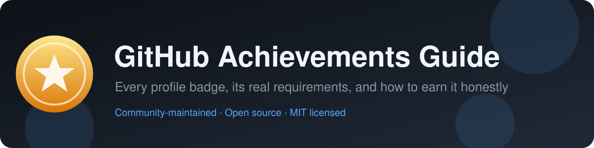

<div align="center">



# GitHub Achievements Guide

**The ultimate open-source guide to GitHub Profile Achievements.**
Discover every badge, understand its requirements, and learn how to unlock it.

[](LICENSE)
[](https://github.com/Y0ussefv/github-achievements-guide/actions/workflows/ci.yml)
[](https://github.com/Y0ussefv/github-achievements-guide/actions/workflows/links.yml)
[](CONTRIBUTING.md)
[](CHANGELOG.md)

[Achievement gallery](#-achievement-gallery) ·
[Progress tracker](#-progress-tracker) ·
[Guides](#-guides) ·
[Contributing](#-contributing) ·
[Sources](#-sources)

</div>

---

## 👋 Introduction

GitHub Profile Achievements are the small badges in the sidebar of a GitHub profile.
They celebrate things like getting a pull request merged, answering a question in
GitHub Discussions, or co-authoring a commit.

GitHub's documentation describes what achievements are and how to show or hide them,
but it **does not publish the exact unlocking rules** for most badges. This guide
collects what is officially documented, what the community has consistently observed,
and clearly labels the difference.

> [!IMPORTANT]
> Achievements are a fun side effect of real participation, not a goal in themselves.
> This guide never encourages spam, fake contributions, purchased stars or any other
> breach of the [GitHub Acceptable Use Policies](https://docs.github.com/en/site-policy/acceptable-use-policies/github-acceptable-use-policies).

### How to read the labels

| Label | Meaning |
| --- | --- |
| ✅ **Official** | Stated in GitHub Docs, the GitHub Changelog or the badge's own text on github.com. |
| 🧪 **Community-reported** | Not documented by GitHub, but consistently observed and reported by many users. |
| ❓ **Unverified** | Conflicting or thin reports. Treat as a hint, not a rule. |

## 📚 Table of contents

- [Introduction](#-introduction)
- [Achievement gallery](#-achievement-gallery)
- [Tier thresholds](#-tier-thresholds)
- [Retired, unreleased and highlight badges](#-retired-unreleased-and-highlight-badges)
- [Progress tracker](#-progress-tracker)
- [Guides](#-guides)
- [FAQ](#-faq)
- [Contributing](#-contributing)
- [Sources](#-sources)
- [License](#-license)

## 🏆 Achievement gallery

Seven achievements can currently be earned. Badge images are loaded directly from
GitHub's own asset server and remain the property of GitHub, Inc.

| Badge | Achievement | How it is earned | Levels | Difficulty | Tutorial |
| :---: | --- | --- | :---: | :---: | :---: |
|  | **Quickdraw** | Close an issue or pull request within 5 minutes of opening it | 1 | 🟢 Easy | [Guide](achievements/quickdraw.md) |
|  | **YOLO** | Merge a pull request without a code review | 1 | 🟢 Easy | [Guide](achievements/yolo.md) |
|  | **Pull Shark** | Open pull requests that get merged | 4 | 🟢 → 🔴 | [Guide](achievements/pull-shark.md) |
|  | **Pair Extraordinaire** | Co-author commits on a merged pull request | 4 | 🟢 → 🟠 | [Guide](achievements/pair-extraordinaire.md) |
|  | **Galaxy Brain** | Have your answers accepted in GitHub Discussions | 4 | 🟡 → 🔴 | [Guide](achievements/galaxy-brain.md) |
|  | **Starstruck** | Create a repository that receives many stars | 4 | 🟠 → ⚫ | [Guide](achievements/starstruck.md) |
|  | **Public Sponsor** | Sponsor someone through GitHub Sponsors | 1 | 🟢 Easy (paid) | [Guide](achievements/public-sponsor.md) |

**Difficulty scale:** 🟢 Easy · 🟡 Medium · 🟠 Hard · 🔴 Very hard · ⚫ Exceptional

➡️ Full index with requirement status: [`achievements/README.md`](achievements/README.md)

## 📈 Tier thresholds

Multi-level badges show a tier label (`x2`, `x3`, `x4`) and a different color.
Since **11 September 2026**, profiles display the **highest** tier you have earned
([GitHub Changelog](https://github.blog/changelog/2026-09-11-profiles-now-show-your-highest-achievement-badge-tier/)).

| Achievement | Base | Bronze (`x2`) | Silver (`x3`) | Gold (`x4`) | Status |
| --- | :---: | :---: | :---: | :---: | :---: |
| Pull Shark | 2 | 16 | 128 | 1024 | 🧪 |
| Pair Extraordinaire | 1 | 10 | 24 | 48 | 🧪 |
| Galaxy Brain | 2 | 8 | 16 | 32 | 🧪 |
| Starstruck | 16 | 128 | 512 | 4096 | 🧪 |

<details>
<summary><b>Why are the thresholds marked “community-reported”?</b></summary>

GitHub does not publish these numbers. They come from users comparing their own
counts with the tier they received, and they have been stable across many independent
community references since 2022. If GitHub publishes official numbers, this table will
be updated — please [open an issue](https://github.com/Y0ussefv/github-achievements-guide/issues/new/choose)
if you notice a change.

</details>

## 📦 Retired, unreleased and highlight badges

<details>
<summary><b>Retired — can no longer be earned</b></summary>

| Badge | Name | What it was |
| :---: | --- | --- |
|  | Arctic Code Vault Contributor | Contributed code to a repository included in the 2020 GitHub Archive Program snapshot. |
|  | Mars 2020 Helicopter Contributor | Authored commits in repositories used by the Mars 2020 helicopter mission. GitHub Docs confirms the event has ended. |

</details>

<details>
<summary><b>Unreleased / experimental — not currently earnable</b></summary>

| Badge | Name | Status |
| :---: | --- | --- |
|  | Heart On Your Sleeve | Artwork exists on GitHub's servers; criteria never officially published. ❓ |
|  | Open Sourcerer | Artwork exists on GitHub's servers; criteria never officially published. ❓ |

</details>

<details>
<summary><b>Highlights — shown on profiles but not achievements</b></summary>

Developer Program Member, PRO, Security Bug Bounty Hunter, GitHub Campus Expert and
Security advisory credit appear in a profile's **Highlights** section. They reflect
program membership or a subscription rather than activity.

</details>

Details: [`achievements/other-achievements.md`](achievements/other-achievements.md)

## ✅ Progress tracker

Copy this checklist into your own notes, issue or profile README.

```markdown
### My GitHub Achievements

- [ ] Quickdraw
- [ ] YOLO
- [ ] Pull Shark (2 merged PRs)
  - [ ] Bronze x2 (16) - [ ] Silver x3 (128) - [ ] Gold x4 (1024)
- [ ] Pair Extraordinaire (1 co-authored merged PR)
  - [ ] Bronze x2 (10) - [ ] Silver x3 (24) - [ ] Gold x4 (48)
- [ ] Galaxy Brain (2 accepted answers)
  - [ ] Bronze x2 (8) - [ ] Silver x3 (16) - [ ] Gold x4 (32)
- [ ] Starstruck (16 stars)
  - [ ] Bronze x2 (128) - [ ] Silver x3 (512) - [ ] Gold x4 (4096)
- [ ] Public Sponsor
```

> [!NOTE]
> Ticking a box does **not** sync with GitHub. Your real achievements are only those
> shown on your profile. A longer tracker lives in [`guides/progress-tracker.md`](guides/progress-tracker.md).

## 🧭 Guides

| Guide | What you will learn |
| --- | --- |
| [Getting started](guides/getting-started.md) | Where achievements appear, how to show/hide them, and a first-day plan |
| [Profile optimization](guides/github-profile-optimization.md) | Profile README, pinned repos and making your profile useful |
| [Open-source contributions](guides/open-source-contributions.md) | Finding projects and getting your first PR merged |
| [GitHub Discussions](guides/github-discussions.md) | Writing answers that get accepted |
| [Common mistakes](guides/common-mistakes.md) | Why a badge did not appear, and what not to do |
| [Progress tracker](guides/progress-tracker.md) | A copy-paste checklist with tiers |

## ❓ FAQ

<details>
<summary><b>How long does it take for an achievement to appear?</b></summary>

Often minutes, sometimes longer. Community reports commonly mention up to 24 hours.
Check in a private/incognito window to rule out caching.

</details>

<details>
<summary><b>Do private repositories count?</b></summary>

GitHub lets you choose whether private contributions are shown and counted toward
achievements — see [Manage visibility settings for private contributions and achievements](https://docs.github.com/en/account-and-profile/how-tos/contribution-settings/manage-visibility-settings-for-private-contributions-and-achievements).
Exactly which badges count private activity is not documented. ❓

</details>

<details>
<summary><b>Can I hide an achievement?</b></summary>

Yes. Hide all of them under **Settings → Public profile → Show Achievements on my profile**,
or hide one by clicking it on your profile and choosing **Hide from profile**.

</details>

<details>
<summary><b>Are achievements permanent?</b></summary>

Once earned they generally stay, but GitHub labels the feature as
**public preview and subject to change** in its
[profile reference](https://docs.github.com/en/account-and-profile/reference/profile-reference).

</details>

## 🤝 Contributing

Found an outdated requirement, a new badge or a typo? Contributions are very welcome.

1. Read [`CONTRIBUTING.md`](CONTRIBUTING.md).
2. [Open an issue](https://github.com/Y0ussefv/github-achievements-guide/issues/new/choose) using a template.
3. Send a pull request with a **source** for any factual change.

Please follow the [Code of Conduct](CODE_OF_CONDUCT.md).

## 🔗 Sources

- GitHub Docs — [About your profile](https://docs.github.com/en/account-and-profile/concepts/personal-profile)
- GitHub Docs — [Profile reference](https://docs.github.com/en/account-and-profile/reference/profile-reference)
- GitHub Docs — [Manage visibility settings for private contributions and achievements](https://docs.github.com/en/account-and-profile/how-tos/contribution-settings/manage-visibility-settings-for-private-contributions-and-achievements)
- GitHub Changelog — [Profiles now show your highest achievement badge tier](https://github.blog/changelog/2026-09-11-profiles-now-show-your-highest-achievement-badge-tier/)
- Full list: [`resources/official-links.md`](resources/official-links.md)

## 📄 License

Text and code in this repository are released under the [MIT License](LICENSE).
Badge artwork is owned by GitHub, Inc. and is referenced, not redistributed — see
[`assets/badges/README.md`](assets/badges/README.md).

This is a community project and is **not affiliated with or endorsed by GitHub, Inc.**

<div align="center">

**Keywords:** GitHub Achievements Guide · How to get GitHub badges · GitHub Profile Achievements ·
GitHub Pull Shark · GitHub Quickdraw · GitHub Galaxy Brain · GitHub YOLO · GitHub Starstruck ·
GitHub Pair Extraordinaire · GitHub Public Sponsor

⭐ If this guide helped you, consider starring it — honestly earned stars only!

</div>
